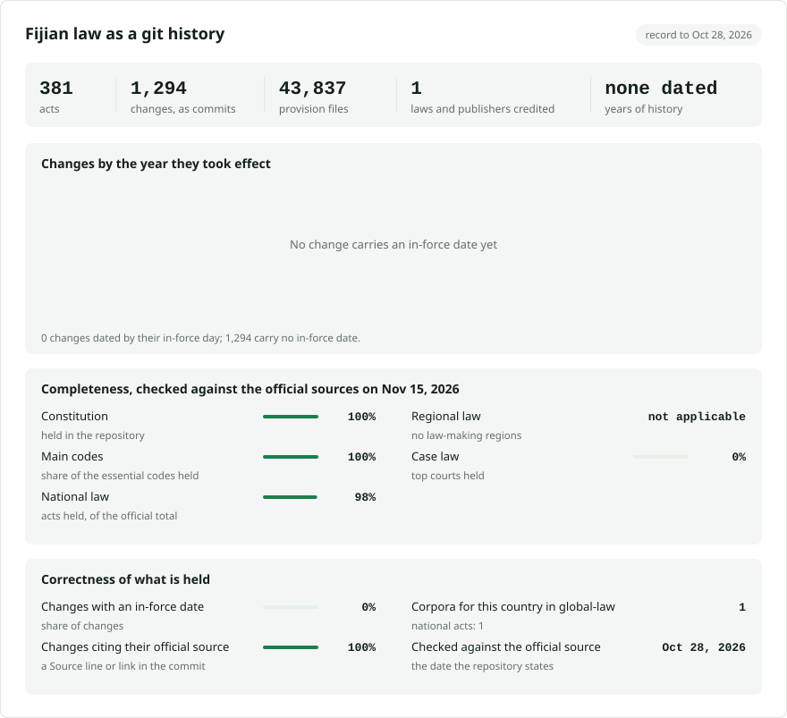

# Fiji: law history in git

<picture>
<source media="(prefers-color-scheme: dark)" srcset="data/effort-dark.svg">

</picture>

The law of Fiji as a git history: one file per section, regulation, schedule or form, one commit per consolidation on the day the official site last updated it, and the publisher as each commit's author. laws.gov.fj keeps only the current text of each law, so each law has one version here so far; later consolidations are to be appended as new commits, so that `git log` and `git diff` show each change line by line.

Part of [lexifina/global-law](https://github.com/lexifina/global-law), one git history for every country's law: this is Fiji's national law, which global-law reads at `fiji/national/acts/`.

**What is in it now:** 1,294 laws as laws.gov.fj consolidates them, each in one version dated between 1928 and 2026: 381 Acts, among them the Constitution of 2013 (in the Schedule to its Promulgation Act), and 913 pieces of subsidiary legislation. [`laws.csv`](laws.csv) lists every law with its kind, parent Act and date; [`data/amendments.csv`](data/amendments.csv) holds the Tables of Amendments (4,292 rows naming 3,030 amending laws) and the 12,744 history notes printed under sections.

Each law is a folder `<kind>/<year>/<name>/`, with one file per unit, a `title.md` (its title, long title and Table of Amendments) and an `index.txt` (its files in order): `act/2007/employment-relations/S59.md` is section 59, paid annual holidays, of the Employment Relations Act 2007, and `act/2013/constitution-of-the-republic-of-fiji-promulgation/SCH.S1.md` is section 1 of the Constitution. [`data/paths.json`](data/paths.json) maps each law's former folder to its present one; 35 folders not placed by that rule keep their former names, under `subsidiary/` and `acts/`.

The text is in English, as laws.gov.fj prints it, one paragraph per line; each section ends with the history note the consolidation prints (`[s 1A insrt Act 44 of 2017 s 57, effective 4 December 2018]`).

## Questions as git commands

| Question | Command |
| --- | --- |
| Every change to section 59 of the Employment Relations Act | `git log -p --word-diff --follow -- act/2007/employment-relations/S59.md` |
| Which consolidation wrote each line of section 59? | `git blame act/2007/employment-relations/S59.md` |
| Every version of section 59, with the day the site last updated it | `git log --follow --diff-filter=AM --format="%h %(trailers:key=Consolidated,valueonly,separator=) %an" -- act/2007/employment-relations/S59.md` |
| Section 59 as the record holds it on 14 November 2026 | `python tools/in_force_on.py 2026-11-14 act/2007/employment-relations S59` |

**Outside git**, we also host this record publicly, for free:

- **[Ask Claude about Fijian law](https://global-law.lexifina.com/v1/try_claude?country=fiji)**: opens Claude with a first question ready.
- **[Ask ChatGPT](https://global-law.lexifina.com/v1/try_chatgpt?country=fiji)**: the same question in ChatGPT.
- **[Search Fijian law on our site](https://lexifina.com/law?country=fiji&q=annual+leave)**: a search for "annual leave", with each provision's text and its versions, no account needed.
- **[Developer REST API](https://global-law.lexifina.com/v1/search_law?query=annual+leave&jurisdiction=fiji)**: the same search as JSON, with no key. See the [documentation here](https://lexifina.com/api/global-law).

Both assistants read the record through the free Global law connector (MCP, `https://global-law.lexifina.com/mcp`); the first time, the chat gives you the link that adds it. Ask in English.

**Host it yourself easily.** All it takes is git and Python, and the tools run on your machine:

```sh
git clone --depth 1 https://github.com/lexifina/global-law && cd global-law
python3 tools/countries.py add fiji/national/acts
python3 tools/law.py show 2026-11-14 fiji/national/acts/act/2007/employment-relations/S59.md
```

Opened in Claude Code, Cursor, VS Code or Codex, the clone also starts a local MCP server with the same tools ([MCP.md](https://github.com/lexifina/global-law/blob/main/MCP.md)).

## Dates

Each law's commit is dated at noon, Fiji time (UTC+12), on the day laws.gov.fj gives as the law's last update, and carries it in its `Consolidated:` trailer:

- it is the day of the consolidation, not the day any amendment took effect, and not proof that the text was in force that day; commencement days are in each Table of Amendments and effective days in the history notes, and `data/amendments.csv` keeps both as printed;
- for the 257 laws the site gives no date, the day the text was retrieved, 2026-10-28 (`Date-source: retrieved`);
- git cannot store dates before 1970, so the 25 earlier commits are dated from 1970-01-01, one second apart, with the real day in `Consolidated:`. Ask for a date with global-law's `law.py show` (above), or with `tools/in_force_on.py` for a day from 2026-11-10; not with `git log --before`.

Every law's commit is credited to the publisher, `Laws of Fiji (Office of the Attorney-General)` (`Kind: consolidated`): without the earlier text nobody can tell which words an amendment wrote. When a later consolidation changes the text, the change is credited to an amending law only where a new history note names one; otherwise it is the publisher's, as `Kind: unexplained`.

## How it is checked

- The build in `tools/build/` is deterministic: [`data/source-sha256.tsv`](data/source-sha256.tsv) holds the sha256 of every laws.gov.fj answer it read, and two builds from the same answers gave the same commit hashes (see [`REPRODUCE.md`](REPRODUCE.md)).
- The text `tools/in_force_on.py` prints for sample sections was compared with the live site.
- Every commit's trailers parse; there are no merge commits, commit dates never go back and none is in the future.
- History is append-only: the move of 1,258 laws to their present folders (2026-11-10) is a commit of its own, with no law text changed.

## What it does not show

- **Any text but the consolidation retrieved on 2026-10-28.** laws.gov.fj keeps no earlier versions, and the Tables of Amendments and history notes say what changed, not the words before; later consolidations have not been read yet.
- **Amendments not yet commenced or not yet incorporated.** Some Tables of Amendments say so in a footnote, copied into `title.md`.
- **Repealed and omitted laws**, which the site publishes only as scanned PDF volumes, and **Acts as made** (its "Laws as published" PDFs, from 2014).
- **Nine laws the site lists with no text** and one part of the Limitation Act 1971 it did not serve; [`data/unreadable.csv`](data/unreadable.csv) lists them, with the laws dated by retrieval.
- **Pictures** (marked `[image]`) and the site's page and paragraph numbering.
- **Case law** is not part of this record.

## Sources

| Source | Kind | Past versions | Notes |
| --- | --- | --- | --- |
| [Laws of Fiji](https://www.laws.gov.fj) (Office of the Attorney-General) | Official consolidation site | no, the current text only | Read through its JSON API: the list of Acts, each Act's table of contents with its subsidiary legislation, and the HTML of every entry; the site says it is not authoritative |

## Licence

See [`LICENSE`](LICENSE). The Laws of Fiji website states no licence for reuse; the texts are reproduced without change to their wording, only split into files and lines. Lexifina's own contributions (the tools, the arrangement, the commit messages and the documentation) are CC0 1.0.

## More

From [lexifina/global-law](https://github.com/lexifina/global-law):

- [FEATURES.md](https://github.com/lexifina/global-law/blob/main/FEATURES.md): every feature, and what every corpus must support (`git blame`, `law.py`, the MCP tools)
- [FAQ.md](https://github.com/lexifina/global-law/blob/main/FAQ.md): questions and answers · [CONTRIBUTING.md](https://github.com/lexifina/global-law/blob/main/CONTRIBUTING.md): proposing changes · [MCP.md](https://github.com/lexifina/global-law/blob/main/MCP.md): the MCP server · [REPRODUCE.md](https://github.com/lexifina/global-law/blob/main/REPRODUCE.md): how it was built · [CHANGELOG.md](https://github.com/lexifina/global-law/blob/main/CHANGELOG.md)
- [FRESHNESS.md](https://github.com/lexifina/global-law/blob/main/FRESHNESS.md): how current each corpus is · [Monitoring](https://github.com/lexifina/global-law/tree/main/monitoring): whether updates are running · [WATCHING.md](https://github.com/lexifina/global-law/blob/main/WATCHING.md): how each official source is watched for changes
- [performance/](https://github.com/lexifina/global-law/tree/main/performance): how fast the tools are, measured
- [visualisations/](https://github.com/lexifina/global-law/tree/main/visualisations): charts and bridges across the world's law
- [Vulnerabilities](https://github.com/lexifina/global-law/tree/main/vulnerabilities): mistakes in legislation as published
